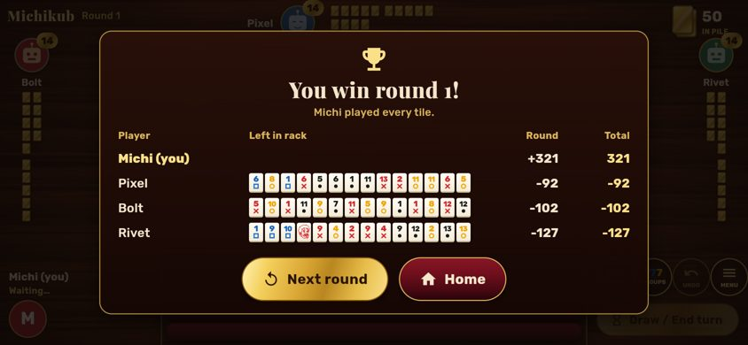

# Michikub

An ad-free number-tile game for 2 to 4 friends. Phones connect directly to each other over the internet (WebRTC), with no game server, no accounts and no cloud storage. It's built with Flutter for Android and iPhone.

> Version 0.1.0 is the first playable build. Design choices made along the way are listed in [DESIGN_QUESTIONS.md](DESIGN_QUESTIONS.md) for review.


## What's in it

- **Practice vs bots**: you against 1 to 3 computer players, each set to Easy, Medium or Hard.
- **Pass-and-play**: 2 to 4 people on one phone, with a "pass the phone to…" cover screen between turns.
- **Host a game / Join a game**: online play with a 6-character room code: Share sends friends a link that opens the room.
- **House rules with saved presets**: first meld (Off or 3 to 50), starting hand (7 to 20), jokers (0 to 4: red, black, yellow, blue), turn timer (Off/30/60/120 s) and tiles drawn when passing (1 to 3).
- **The table**: a mahogany table, a crimson velvet rack (10 per row, sliding up for a second row), gold face-down tiles for opponents, flying draw and play animations, and large suit symbols.
- **Gestures**: drag anywhere. Long-press a rack tile to grab its run or group. Long-press a table set to move it. Double-tap to split a set. Tap a tile then tap a set to auto-place it. An Add row button, an invisible 27-space snap grid with automatic room-making, and a table view that starts zoomed in (3 rows) and zooms out as sets spread. 789 and 777 sort the rack with complete sets first, and Reset puts every tile back where it was at the start of your turn.

Computer players are picked at random from a roster of 6 robots, each with a picture and a tagline (`lib/app/bot_roster.dart`, `assets/bots/`). Practice setup shows who you're up against, and long-pressing a robot's avatar at the table shows its tagline. They decide a turn instantly, wait 1 s at the start of their turn, and then play it out one action at a time: 2 s per new set, 1 s per split or set move, and 0.5 s per single tile. They follow the turn timer like everyone else.

All play, solo modes included, goes through the same rules engine (`lib/engine/`): the host's phone validates every move.

## Testing it by yourself

1. **Practice vs bots**: Home → *Practice vs bots*, choose 1 to 3 bots and their difficulty, then *Start practice*.
2. **Pass-and-play**: Home → *Pass-and-play*, enter 2 to 4 names, then play both sides.
3. **Test tools**: Home → *Options & house rules* → *Test tools*. Switch them on to get:
   - **Fixed deal (seed)**: the same number deals the same tiles every time.
   - **Deal me a joker**: guarantees you a joker in your opening hand.
   - **Draw pile size**: Full, 20, 8, 2 or 0, to reach the empty-pile ending quickly.
   - **Turn timer override**: 10 or 20 s, to test timeouts.
   - **Test buttons in the game menu**: *Win now* (results screen), *Draw 5* (second rack row), *Give me a joker*, *Empty the pile*, and *Timer to 3 s*.
   - Tip: a starting hand of 20 (in house rules) shows the rack's second row right away.

   Test tools only apply to Practice and Pass-and-play, never to online games.

| Practice setup | Results | Pass-and-play |
|---|---|---|
|  |  |  |

## Play in a browser

The web version runs at https://playmichikub.github.io/ (any phone, iPhone included, or a computer). It's served by GitHub Pages from the [PlayMichikub/PlayMichikub.github.io](https://github.com/PlayMichikub/PlayMichikub.github.io) repository, which holds only the built files; the source stays here. To publish the current code, run `tool/deploy_web.sh` (it builds the web version and replaces that repository's `main` branch). An invite link (`https://playmichikub.github.io/?join=CODE`, also shown as a QR code when you host) opens Join with the room code filled in, in the Android app when it's installed and otherwise in the browser. The old address, https://epicultrakingsmizzy.github.io/Michikub/, forwards there (`tool/deploy_old_site_redirect.sh`), so old invites keep working.

## Install on Android

Download `Michikub-v0.1.0.apk` from the [Releases](../../releases) page onto the phone, open it and allow "install unknown apps" for your browser or file manager when asked. The APK is signed with a debug key, which is fine for sideloading. Before a Play Store release it needs a real upload key.

## iPhone

The same code builds for iOS. Getting it onto iPhones needs a **Mac with Xcode** and an **Apple Developer account** ($99/year) to distribute through **TestFlight**: `flutter build ipa`, then upload with Xcode or Transporter. Free installs straight from Xcode stop working after 7 days.

## Build it yourself

Requirements: Flutter stable (3.50+), Android SDK 35/36 with build-tools, and JDK 17.

```bash
flutter pub get
flutter test                 # rules engine, layout and bot tests
flutter build apk --release  # build/app/outputs/flutter-apk/app-release.apk
flutter build web            # handy for quick UI checks in a browser
```

On the web build, `?demo=practice&seed=7` (or `?demo=hotseat`) jumps straight into a seeded game, which is useful for screenshots.

## How online play works

- The host's phone runs the authoritative `GameHost`. Each guest receives only its own rack, plus the shared table and tile counts.
- Matchmaking uses the free public **PeerJS broker** (`0.peerjs.com`), which only passes connection details. After that the phones talk directly over a WebRTC data channel, using Google's public STUN servers.
- **Not yet tested phone to phone.** The broker handshake was checked from the build machine, but WebRTC can't open a connection in that sandbox, so the first real test is on your phones.
- Some strict networks (certain mobile carriers or workplace Wi-Fi) block direct connections. There is deliberately no relay (TURN) server, so test with your group early.

## Project layout

```
lib/engine/   pure Dart: tiles, melds, board layout, host, bots (unit tested)
lib/net/      PeerJS signalling, WebRTC links, online host/guest sessions
lib/app/      saved preferences, local sessions (practice / pass-and-play)
lib/ui/       screens and the game table
test/         engine tests
```

## Credits

- **Space Grotesk Bold** (room codes), by Florian Karsten and the Space Grotesk Project Authors. It's from https://github.com/floriankarsten/space-grotesk and licensed under the SIL Open Font License 1.1. The licence text ships in `assets/fonts/SpaceGrotesk-OFL.txt` and is shown in the app under Options > Open-source licences.
- **Rubik** (body text) and **Playfair** (titles) are bundled in `assets/fonts/`.
- **Sound effects**: CC0 recordings from Freesound and Kenney.nl. Sources are in `assets/sfx/CREDITS.md`.

## License

Copyright (c) 2026 EpicUltraKingSmizzy. All rights reserved. The source is publicly viewable for reference and so friends can play the web build, but you may not copy, modify, distribute or publish it, or make derivative works, without written permission. To ask, contact [EpicUltraKingSmizzy on GitHub](https://github.com/EpicUltraKingSmizzy). Third-party assets (sounds, fonts) keep their own licenses: see `assets/sfx/CREDITS.md` and Credits above. Full text in [LICENSE](LICENSE).
